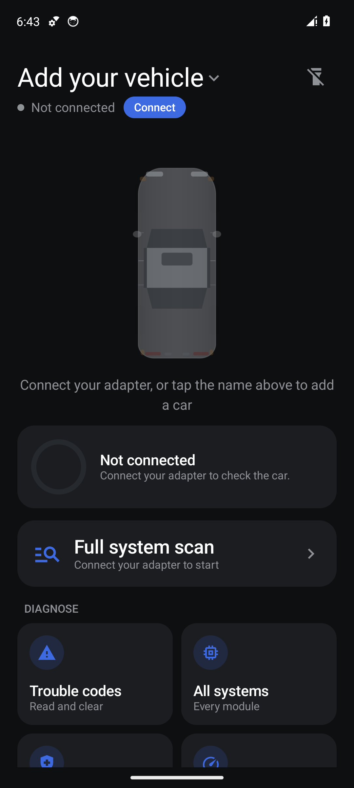
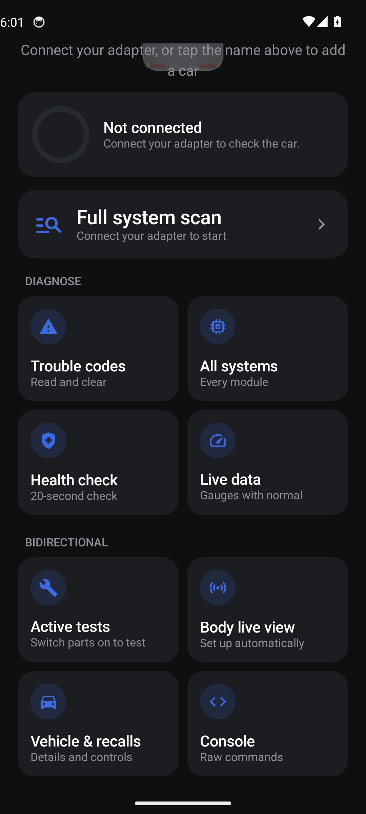
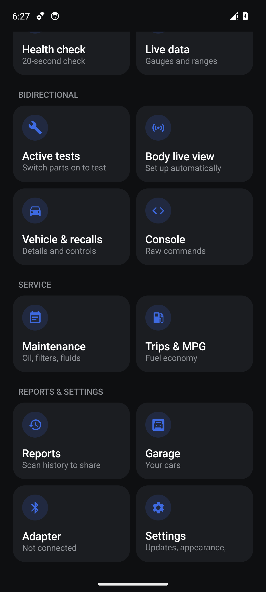
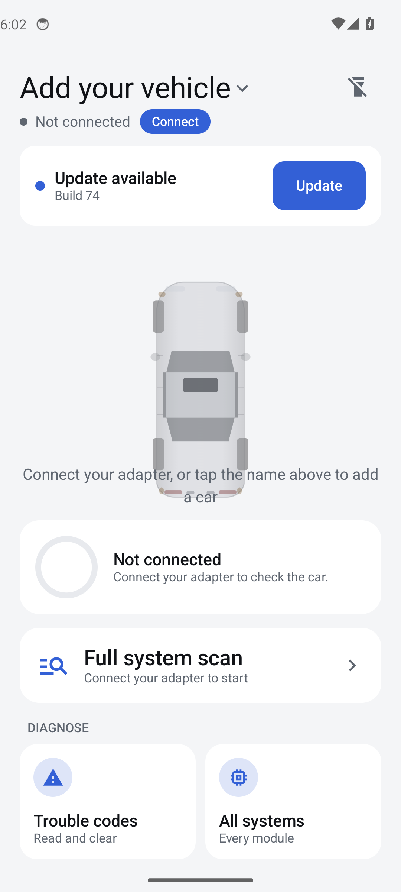
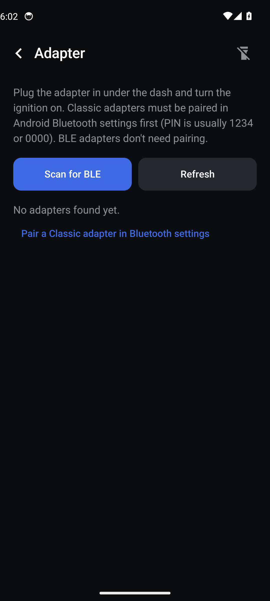
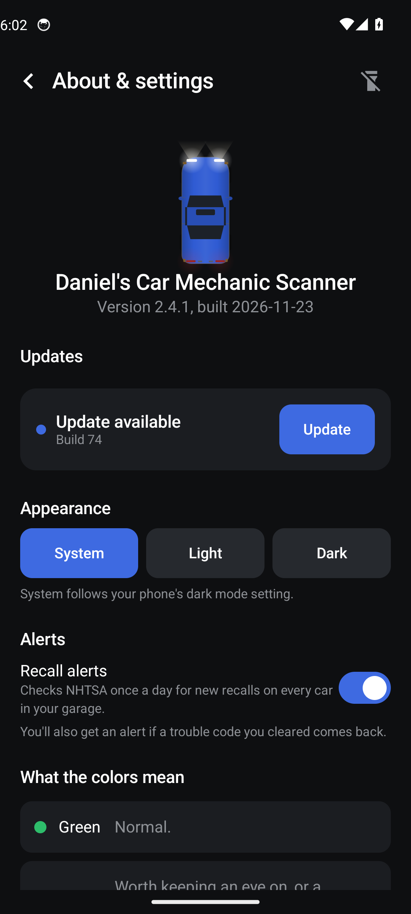

# Daniel's Car Mechanic Scanner

A workshop-style scan tool for Android. Plug an ELM327-compatible OBD2 adapter (Classic Bluetooth or BLE) into your car and get a full system scan, live data, health checks, bidirectional tests and a live drawing of your car that mirrors its doors and lights.

**[Download the latest APK](https://github.com/dannyspace21/Daniel-s-OB2-Scanner/releases/latest)**. After the first install, the app updates itself: when a newer build is out, Home shows **Update available**.

## Screenshots

  
  
  

  
  
  

Screenshots are taken automatically on an Android emulator by **Actions > Screenshots > Run workflow**, so they always match the current build. They show the app before a car is connected.

## What it does

### Diagnose
- **Full system scan**: one tap knocks on every address on the car's network and reads every computer that answers (engine, ABS, airbags, transmission, body, climate, cluster, steering...), including the Toyota/Lexus body network. Codes come with failure type (open circuit, short to ground...) and status (active, confirmed, pending, history). Clear per module or all at once.
- **Trouble codes**: check engine light, stored, pending and permanent codes with descriptions (2,066 built in, work offline), freeze frame, emissions inspection readiness, and clearing with a warning first.
- **Health check**: about 20 seconds at warm idle. Judges battery and charging, cooling, fuel trims, oxygen sensors and catalytic converter, idle, vacuum, timing and codes. Every amber or red result explains what it means and lists likely causes, most common first.
- **Live data**: gauges that turn green, amber or red against normal ranges, and start reading as soon as you open them.

### Bidirectional
- **Body live view**: the drawing on Home mirrors the real car: doors, trunk, hood, locks, brake lights, headlights, high beams, fog, turn signals and hazards (blinking at your car's rate), reverse, interior light, wipers.
- **Set up automatically**: no codes needed. The app finds your car's body data, then asks you to open a door or press the brake and finds the matching signal itself.
- **Active tests**: switch parts on to prove they work, with a confirmation, an automatic time limit, and stop commands that always run.
- **Vehicle & recalls**: details decoded from the VIN, open safety recalls, and Control your car buttons for parts that have a test set up.
- **Console**: raw commands with a safety guard (see below).

### Service
- **Maintenance**: oil, filters and fluids by miles or months, with the odometer read from newer cars.
- **Trips & MPG**: live and average MPG, distance, fuel used and cost, with a trip log per car.

### Reports, alerts and settings
- **Reports**: every scan saved per car and shareable as a text report.
- **Garage**: every car you've connected to or added by VIN, each with its own data.
- **Alerts**: daily recall check for every car in your garage, and a notification if a code you cleared comes back.
- **Home screen widget**, **vehicle history** links (Carfax, AutoCheck, NICB, NMVTIS), **Related for your car** searches, and System / Light / Dark appearance.

### Not included (yet)
Professional scan tools also offer manufacturer service functions such as oil-service reset, electronic parking brake, steering angle and TPMS relearn, battery registration, ABS bleeding and injector coding, plus ready-made bidirectional tests for every car. Those use manufacturer-specific commands that aren't public, and a wrong one can damage the car, so they're added only for specific cars once the commands are confirmed.

## Reading the code

Every file starts with a "WHAT THIS FILE DOES" note, and every function has a plain-English comment above it. Good places to start:

- `obd/Health.kt`: the normal ranges and likely causes. Change a number here to change when something turns amber or red.
- `obd/Modules.kt`: the all-module scanner.
- `net/Nhtsa.kt` and `net/Related.kt`: VIN decoding, recalls and the Related links.
- `ui/VehicleView.kt`: the car drawing and its animations.
- `obd/Pids.kt`: every sensor the app reads, with its formula and normal range.
- `ui/ScannerViewModel.kt`: what happens when you tap each button.
- `ui/Theme.kt`: all the colors.

## Build the APK

1. Install Android Studio (free) and open this folder with **File > Open**.
2. Let Gradle sync. If Studio offers to download an SDK or upgrade the Gradle plugin, accept.
3. **Build > Build App Bundle(s) / APK(s) > Build APK(s)**.
4. The APK lands in `app/build/outputs/apk/debug/app-debug.apk`. Copy it to the phone and open it to install (allow "install unknown apps" for your file manager).

Or let GitHub build it: every push runs the unit tests and builds the APK, and every build on `main` is published as a [Release](https://github.com/dannyspace21/Daniel-s-OB2-Scanner/releases) that the app offers as an in-app update.

The code lives directly in this repository now, so edit and commit files here rather than uploading a zip.

### Signing key

Android only installs an update over the app if both builds were signed with the same key. Keep using the key the app on your phone was installed with (`daniels-scanner.keystore`, alias `daniels`), or updates stop installing. That key is a secret, so it is **never** stored in the repository. GitHub Actions reads it from repository secrets (**Settings > Secrets and variables > Actions > New repository secret**):

| Secret | Value |
|---|---|
| `SIGNING_KEYSTORE_BASE64` | The `.keystore` file, base64-encoded (`base64 -w0 your.keystore` on Linux, `certutil -encode` on Windows) |
| `SIGNING_STORE_PASSWORD` | The keystore password |
| `SIGNING_KEY_ALIAS` | Optional, defaults to `daniels` |
| `SIGNING_KEY_PASSWORD` | Optional, defaults to the keystore password |

Every build checks that the APK is signed with that exact key (SHA-256 fingerprint `AF:7E:29:65:…:C6:B3`, set in `.github/workflows/build.yml`). If the secrets are missing or wrong, the build fails with a clear message instead of giving you an APK that won't install over your app.

For local builds, put the same names in a `keystore.properties` file next to `settings.gradle.kts` (it's git-ignored), with `SIGNING_KEYSTORE_PATH` pointing at the keystore. Without a key, builds are signed with Android's standard debug key.

## Safety guard

Every command the app sends goes through `obd/Safety.kt`:

- **Read requests** go straight through.
- **Actuator commands** (2F, 30) and **code clears** (04, 14) ask you to confirm first.
- **Module-changing commands** (reset, security unlock, write, routines, flashing, programming sessions, network speed changes) and adapter rewrites (`ATPP`, `STPX`) are blocked unless Expert mode is on.
- A command can't contain a line break, so nothing can hide a second command behind the one being checked.
- **Body signals and Watch** may only use read requests, because they repeat several times a second.

The tests in `app/src/test` check these rules on every build.

## Using it

1. Plug in the adapter, ignition on (engine can be off).
2. Classic adapters: pair in Android Bluetooth settings first, PIN usually 1234 or 0000. BLE adapters: tap **Scan for BLE**.
3. Tap your adapter. Connecting can take up to 15 seconds.

## Adding active tests

Actuator commands are specific to the manufacturer and module, so the app ships with none. Only add a command you've confirmed for your exact car.

A test has a module address (7E0 is usually the engine computer on CAN cars), start commands, stop commands, an optional keep-alive (3E00 keeps the session open), and a time limit.

Ways to find the right commands:
- Run Toyota Techstream with a Mini VCI cable while a second adapter in monitor mode (or a CAN sniffer) on a Y-splitter records the traffic, then copy what Techstream sends.
- Owner forums and published research for your model.
- Experiment in the Console with headers on (ATH1). The app explains rejections, e.g. "conditions not correct" or "security access denied".

Some modules need an extended diagnostic session (e.g. `1003`) before they accept actuator commands; put that as the first start command.

## Adapter notes

Cheap ELM327 clones often handle basic codes and live data but fail on manufacturer-specific commands. An OBDLink MX+ or Vgate iCar Pro is far more reliable for active tests.

## Internet

The app uses the internet only to decode the VIN and fetch recalls from NHTSA (U.S. government, free, no account), to check this repository's public Releases page for updates, and to open links you tap. Nothing about you or your car is sent anywhere. Results are saved on the phone so they still show offline.

Updates are downloaded only over https from GitHub, and the app checks the download is signed with its own key before opening Android's installer.

## Safety

Car in Park, parking brake on, nothing near the fan or belts. Don't run tests while driving. Commands that reset, unlock, write or reprogram modules are blocked unless you turn on Expert mode; leave it off unless you know exactly what a command does.
